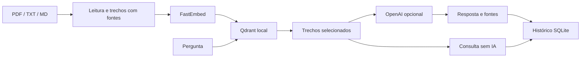
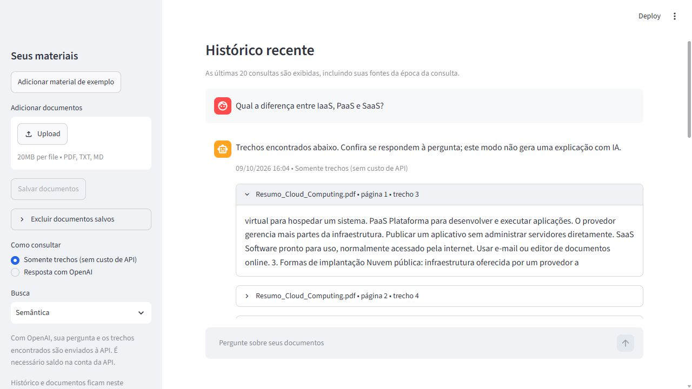

# AI Study Assistant

Assistente pessoal para estudar PDF, TXT e Markdown. Busca conteúdos nos materiais e, com saldo na API OpenAI, gera respostas em português com fontes. Projeto do bootcamp de Cloud e IA.

## Executar no Windows

Na pasta que contém `app.py`:

```powershell
.\.venv\Scripts\python.exe -m pip install -r requirements.txt
.\.venv\Scripts\python.exe -m streamlit run app.py
```

Se ainda não existir ambiente virtual, crie com `python -m venv .venv` antes da instalação. Abra http://127.0.0.1:8501. Envie seus arquivos pela barra lateral e clique em **Salvar documentos**. Também pode colocar arquivos diretamente em `documents/`.

O modo inicial **Somente trechos** funciona sem gastar créditos de API. A busca semântica baixa um modelo público na primeira consulta e depois reutiliza o cache. **Por palavras** é uma alternativa que dispensa esse download.

Para experimentar sem preparar arquivos, clique em **Adicionar material de exemplo** na barra lateral. O exemplo versionado em `examples/cloud.md` funciona também em uma instalação nova e no contêiner.

## OpenAI

Copie `.env.example` para `.env` apenas se ainda não tiver esse arquivo. Preencha localmente `OPENAI_API_KEY` e `OPENAI_MODEL`. Não envie a chave ao GitHub nem a conversas. O modelo padrão é `gpt-4.1-mini`.

A chave já configurada não garante saldo. É necessário crédito e acesso ao modelo na conta da API. Selecione **Resposta com OpenAI** quando sua conta estiver pronta. Pergunta e trechos recuperados serão enviados à OpenAI. O programa pede respostas apoiadas no contexto e valida os IDs das fontes; confira a resposta com o conteúdo citado.

**Validação atual:** busca, envio, histórico e respostas simuladas testados. A geração real permanece pendente de créditos na conta. Não há promessa de qualidade verificada para respostas reais antes desse teste.

## Recursos

- PDF com texto selecionável, TXT e Markdown UTF-8; envio de até 20 MB por arquivo.
- Divisão em trechos com arquivo, página e posição.
- Embeddings multilíngues locais com FastEmbed e Qdrant persistente.
- Na interface, busca combinada por significado e palavras, com trechos vizinhos para completar o contexto; alternativa BM25 por palavras.
- Filtro inicial de resultados semânticos fracos e busca por palavras automática quando a busca semântica falha.
- Respostas pela Responses API com referências validadas e mensagens de erro.
- Histórico persistente em SQLite, exibindo as últimas 20 consultas.
- Logs de eventos sem perguntas, documentos ou chaves.
- Interface Streamlit e configuração Docker Compose.

O histórico mantém as fontes como estavam na consulta. Documentos adicionados têm nomes seguros com identificador do conteúdo, evitando sobrescrever materiais diferentes. PDFs digitalizados exigem OCR, ainda não incluído.

Para excluir materiais, abra **Excluir documentos salvos** na barra lateral, selecione os arquivos, marque a confirmação e clique em **Excluir selecionados**. A exclusão apaga permanentemente os arquivos da pasta `documents/` do projeto. Eles deixam de participar das novas buscas; consultas antigas e seus trechos permanecem no histórico.

## Arquitetura



Interface em `app.py`; leitura, busca, geração, histórico e envio em `src/ai_study_assistant/`. Modelos em `data/models/`, banco da interface em `data/web/qdrant/`, histórico em `data/history.sqlite3` e logs rotativos em `data/app.log`. Esses dados são excluídos do Git. O banco do terminal é separado em `data/qdrant/`, evitando conflito com a interface. Execute somente uma instância da interface por vez.

Arquivo alterado é relido; os demais usam um cache de leitura. Um novo conjunto de documentos substitui o índice antigo. Ao excluir materiais pela interface, os índices derivados são limpos e reconstruídos na próxima consulta. Se outro processo mantiver um índice aberto, a interface avisa para encerrá-lo. Documentos pessoais enviados são ignorados pelo Git; o PDF de exemplo já versionado é uma exceção.

## Terminal

```powershell
.\.venv\Scripts\python.exe main.py
.\.venv\Scripts\python.exe main.py --search-only
.\.venv\Scripts\python.exe main.py --keywords
```

Digite `sair` para encerrar. Terminal e interface compartilham o histórico e a recuperação de contexto. PDFs inválidos são ignorados com aviso, permitindo consultar os demais materiais.

## Testes

```powershell
.\.venv\Scripts\python.exe -m unittest discover -s tests -v
```

Verificam referências, índice persistente, documentos alterados, respostas sem contexto, erros da API, validação de envio, histórico e interface. As chamadas OpenAI são simuladas e não gastam créditos. Os testes não medem precisão de respostas de um modelo real.

Para avaliar oito exemplos de busca com o modelo local real, sem chamar a OpenAI:

```powershell
.\.venv\Scripts\python.exe scripts/evaluate_retrieval.py
```

Após adicionar créditos, esta verificação faz **uma chamada real à API**, com material público de exemplo e cobrança na conta:

```powershell
.\.venv\Scripts\python.exe scripts/verify_openai.py
```

Confira manualmente a explicação e as fontes. O filtro semântico inicial é 0,30: uma heurística calibrada em poucos exemplos, que pode precisar de ajuste para outros materiais. O BM25 também pode encontrar palavras em contextos inadequados. Não é uma medida de confiança nem garantia de precisão. Veja [registro da validação](docs/VALIDACAO.md).

## Docker

Requer Docker Desktop funcionando e arquivo `.env` (pode ter chave vazia para consultar somente trechos).

```powershell
docker compose up --build
```

Abra http://127.0.0.1:8501 e envie materiais pela interface. Documentos locais e `.env` não são copiados para a imagem; o Compose fornece as variáveis e os volumes preservam os dados. O primeiro uso semântico no contêiner baixa o modelo. Para parar preservando os dados: `docker compose down`.

Docker e WSL não estão instalados neste computador, portanto o build ainda não foi validado localmente. O GitHub Actions está configurado para executar testes e verificar o build e a inicialização do contêiner após o código ser enviado ao GitHub; esse fluxo ainda não foi executado. O aplicativo não tem autenticação própria: é para uso pessoal local ou acesso privado pelo roteiro abaixo.

## Deploy pessoal

O [guia de deploy](docs/DEPLOY.md) explica como usar uma VM Ubuntu no Azure, Docker Compose e um túnel SSH. Documentos e histórico ficam em volumes persistentes, e o aplicativo só é acessível pelo túnel. O guia inclui configuração, backup, validação e acompanhamento de custos. Nenhum recurso de nuvem foi criado nesta entrega.

Para o portfólio, pode publicar o código e uma demonstração com o exemplo, mantendo seus documentos e sua instância privados. Veja [currículo, pitch e roteiro de demonstração](docs/PORTFOLIO.md).

Antes de clonar a entrega na VM, siga o [guia para enviar o código ao GitHub](docs/GITHUB.md).

## Demonstração e aprendizado

Perguntas sugeridas: `Qual a diferença entre IaaS, PaaS e SaaS?`, `Qual serviço do Google permite salvar arquivos?`, `Quais são as vantagens da nuvem?`. Abra os trechos e confira o conteúdo. Teste também um assunto que não aparece nos materiais: a busca pode retornar resultados fracos e a IA deve recusar quando faltar informação.

Veja `docs/ESTUDO.md` para o resumo do bootcamp.



## O que aprendi (What I learned)

- Organizar módulos Python com responsabilidades diferentes.
- Extrair documentos e manter referências de arquivo, página e trecho.
- Comparar buscas por palavras e por significado; avaliar resultados fora do tema.
- Integrar uma API com contexto recuperado e validar fontes em respostas estruturadas.
- Guardar histórico em SQLite e configurar dados privados fora do Git.
- Testar comportamentos, lidar com falhas e preparar um ambiente reproduzível com Docker.

## Licença

Código distribuído sob a [licença MIT](LICENSE). A licença do aplicativo não altera direitos dos documentos que você adicionar.

## Referências

- [Streamlit: envio de arquivos](https://docs.streamlit.io/develop/api-reference/widgets/st.file_uploader)
- [FastEmbed](https://qdrant.github.io/fastembed/Getting%20Started/)
- [Qdrant Python Client](https://github.com/qdrant/qdrant-client)
- [OpenAI Responses API](https://developers.openai.com/api/reference/python/resources/responses/methods/create)
- [Docker Compose](https://docs.docker.com/compose/gettingstarted/)
