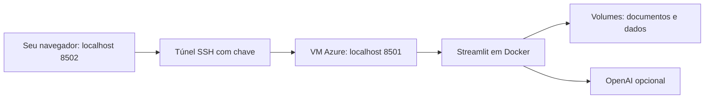

# Deploy pessoal do AI Study Assistant

Este roteiro coloca o projeto em uma máquina virtual Linux no Azure, mantendo o acesso ao aplicativo pelo seu computador. É uma opção de aprendizado de Cloud; você também pode continuar usando a versão local no Windows.

**Situação da entrega:** o roteiro e a configuração Docker estão preparados. O build Docker e este deploy ainda precisam ser executados e validados; não houve criação de recursos na nuvem. Respostas reais da OpenAI dependem de créditos e acesso ao modelo na sua conta da API.

## 1. Entender a arquitetura



O aplicativo é para uma pessoa e não possui login próprio. No roteiro, a autenticação é a chave SSH e a porta do Streamlit fica ligada ao endereço local da VM. Mantenha o `compose.yaml` com `127.0.0.1:8501:8501`. Não abra a porta 8501 no Azure. A vinculação a localhost restringe o acesso direto à porta publicada. [Docker: publicação de portas](https://docs.docker.com/engine/network/port-publishing/).

## 2. Preparar a conta e estimar custos

Você precisará de uma assinatura Azure, uma chave SSH e do código no seu repositório. No Windows, confira no PowerShell se `ssh -V` funciona; se faltar, instale o recurso opcional **Cliente OpenSSH** do Windows.

Antes de criar a VM, consulte a [calculadora oficial do Azure](https://azure.microsoft.com/en-us/pricing/calculator/). Estime máquina virtual, disco, IP público e transferência de dados. O uso da OpenAI tem cobrança separada. Não há valor fixo nem promessa de gratuidade neste roteiro.

Para começar os testes, sugiro **Ubuntu Server 24.04 LTS, arquitetura x86_64, pelo menos 2 vCPU e 4 GB de RAM**, com disco de aproximadamente 32 GB. Esta é uma estimativa de engenharia para um único usuário com materiais pequenos; ajuste conforme o consumo observado. O download do modelo semântico exige acesso à internet e armazenamento. A busca por palavras dispensa esse download.

## 3. Criar a VM pelo portal Azure

No portal, procure **Máquinas virtuais → Criar**. Use um grupo dedicado, como `rg-ai-study`, e dê à VM um nome como `vm-ai-study`. Escolha a região e o tamanho após conferir a estimativa. Configure o usuário `azureuser` e autenticação por chave SSH; guarde o arquivo privado `.pem` somente no seu computador. [Microsoft: criar VM Linux](https://learn.microsoft.com/en-us/azure/virtual-machines/linux/quick-create-portal).

Na rede, permita **somente SSH/TCP 22** com origem limitada ao seu IP público, em formato `SEU_IP/32`. Não crie regras para HTTP, HTTPS ou 8501. Se seu IP mudar, atualize a origem da regra. O portal permite ajustar a regra em **Rede** da VM. [Microsoft: conexão e regras SSH](https://learn.microsoft.com/en-us/azure/virtual-machines/linux-vm-connect).

Revise custos e configurações antes de clicar em **Criar**. Esta é a etapa em que você contrata os recursos. Depois da criação, copie o IP público da VM.

## 4. Conectar pelo Windows

Os exemplos contêm nomes de substituição. Troque `IP_DA_VM` pelo IP público real e o caminho `.pem` pelo arquivo baixado; nunca substitua esses campos pela chave da OpenAI.

No PowerShell:

```powershell
ssh -i "C:\Users\Usuario\Downloads\ai-study.pem" azureuser@IP_DA_VM
```

Na primeira conexão, confira a impressão digital da chave do servidor pelo portal antes de aceitar. A orientação da Microsoft explica como obtê-la usando **Executar comando**. Não desative a verificação de chave do servidor. [Microsoft: conexão SSH](https://learn.microsoft.com/en-us/azure/virtual-machines/linux-vm-connect).

A partir daqui, os comandos do próximo tópico são executados no terminal **Ubuntu da VM**, dentro dessa conexão SSH.

## 5. Instalar Docker e Git na VM

Para uma VM Ubuntu 24.04 nova, configure o repositório oficial do Docker:

```bash
sudo apt update
sudo apt install -y ca-certificates curl git
sudo install -m 0755 -d /etc/apt/keyrings
sudo curl -fsSL https://download.docker.com/linux/ubuntu/gpg -o /etc/apt/keyrings/docker.asc
sudo chmod a+r /etc/apt/keyrings/docker.asc
sudo tee /etc/apt/sources.list.d/docker.sources > /dev/null <<'EOF'
Types: deb
URIs: https://download.docker.com/linux/ubuntu
Suites: noble
Components: stable
Architectures: amd64
Signed-By: /etc/apt/keyrings/docker.asc
EOF
sudo apt update
sudo apt install -y docker-ce docker-ce-cli containerd.io docker-buildx-plugin docker-compose-plugin
sudo docker run --rm hello-world
sudo docker compose version
```

`noble` e `amd64` correspondem ao Ubuntu 24.04 x86_64 escolhido. Para outra imagem, siga as instruções correspondentes na [instalação oficial do Docker para Ubuntu](https://docs.docker.com/engine/install/ubuntu/). Este roteiro usa `sudo docker` e o comando atual `docker compose`, com espaço.

## 6. Baixar o projeto e configurar a API

No Ubuntu, troque o endereço pelo seu repositório:

```bash
git clone https://github.com/SEU_USUARIO/ai-study-assistant.git
cd ai-study-assistant
```

Se o repositório for privado, use um método de autenticação do GitHub. Não coloque tokens no endereço do comando.

Na primeira configuração, **apenas se `.env` ainda não existir**:

```bash
cp .env.example .env
chmod 600 .env
nano .env
```

Preencha a chave somente no editor da VM para usar a OpenAI. Você pode deixar a chave vazia para consultar documentos sem geração pela API. O arquivo deve continuar fora do Git. Não use `cat .env`, não envie a chave a conversas e não mostre esse arquivo em gravações.

Os documentos e o histórico do seu Windows não são enviados automaticamente pelo Git. Para começar na VM, envie seus materiais pela interface depois de abrir o túnel. Use somente materiais que você quer armazenar nessa VM.

## 7. Construir e iniciar

Ainda na pasta do projeto, no Ubuntu:

```bash
sudo docker compose config --quiet
sudo docker compose up -d --build
sudo docker compose ps
sudo docker compose logs --tail=50 assistant
curl --fail http://127.0.0.1:8501/_stcore/health
```

`config --quiet` valida a configuração sem imprimir as variáveis de ambiente. O build pode levar alguns minutos. O retorno do endpoint de saúde confirma que o servidor iniciou, mas não testa a busca nem a OpenAI. [Docker Compose: execução e inspeção](https://docs.docker.com/compose/gettingstarted/).

Se falhar, confira a mensagem nos logs antes de seguir. Não compartilhe uma saída que contenha credenciais.

## 8. Abrir o aplicativo pelo túnel SSH

Abra **outro PowerShell no seu Windows** e execute:

```powershell
ssh -i "C:\Users\Usuario\Downloads\ai-study.pem" -N -o ExitOnForwardFailure=yes -o ServerAliveInterval=30 -L 127.0.0.1:8502:127.0.0.1:8501 azureuser@IP_DA_VM
```

Deixe esse terminal aberto. A ausência de um prompt novo é normal: ele mantém o túnel. Abra [http://127.0.0.1:8502](http://127.0.0.1:8502) no navegador do Windows. Usamos 8502 para evitar conflito com a versão local em 8501. Para fechar o túnel, pressione `Ctrl+C` nesse terminal. O `-L` encaminha a porta local pelo SSH e o `-N` mantém a conexão sem executar um comando remoto. [Manual oficial OpenSSH](https://man.openbsd.org/ssh).

O endereço que abre no navegador é local, mas o aplicativo e seus dados estão na VM. O túnel protege o caminho até a VM. Ao selecionar OpenAI, a pergunta e os trechos relevantes são enviados ao serviço da API.

## 9. Validar antes de considerar o deploy concluído

1. Envie um pequeno PDF com texto selecionável, TXT ou Markdown.
2. Faça uma pergunta cuja resposta você conhece e confira os trechos e páginas.
3. Consulte o histórico e atualize a página para conferir a persistência.
4. Reinicie o contêiner e verifique se documento e histórico continuam presentes.
5. Exclua um material de teste e confira que ele não aparece em novas buscas.
6. Se houver crédito, teste a OpenAI com uma pergunta respondida no material e uma pergunta fora dele; confira resposta e fontes.
7. Registre versão do código, resultado e data em `docs/VALIDACAO.md`.

Uma busca relacionada não garante uma resposta correta. O modo sem API deve funcionar independentemente dos créditos. Falta de saldo não comprova um defeito na busca.

## 10. Persistência e backup

O Compose usa os volumes `study_documents` em `/app/documents` e `study_data` em `/app/data`. A pasta de dados contém histórico, índice, cache do modelo e logs. Volumes persistem quando um contêiner é substituído, mas são dados da VM; não são um backup externo. [Docker: volumes](https://docs.docker.com/engine/storage/volumes/).

No Ubuntu, dentro da pasta do projeto, faça uma cópia com a aplicação parada:

```bash
mkdir -p backups
chmod 700 backups
sudo docker compose stop assistant
sudo docker compose run --rm --no-deps --user root -v "$PWD/backups:/backup" assistant python -c '
from datetime import datetime
import tarfile
path = "/backup/study-" + datetime.now().strftime("%Y%m%d-%H%M%S") + ".tar.gz"
with tarfile.open(path, "w:gz") as archive:
    archive.add("/app/data", arcname="data")
    archive.add("/app/documents", arcname="documents")
print(path)
'
sudo docker compose up -d
```

Baixe o arquivo gerado para seu Windows com `scp`, substituindo `NOME_DO_BACKUP` pelo nome mostrado:

```powershell
scp -i "C:\Users\Usuario\Downloads\ai-study.pem" azureuser@IP_DA_VM:/home/azureuser/ai-study-assistant/backups/NOME_DO_BACKUP.tar.gz "C:\Users\Usuario\Documents\Codex\"
```

Guarde a cópia em local privado. O arquivo inclui o conteúdo dos documentos e do histórico; não inclui `.env`. Para migrar, restaure em volumes vazios, com a aplicação parada, e configure `.env` separadamente. Consulte o procedimento de [backup e restauração de volumes](https://docs.docker.com/engine/storage/volumes/#back-up-restore-or-migrate-data-volumes) e valide a recuperação antes de apagar a VM antiga. O comando de backup deste projeto ainda precisa ser testado quando o Docker estiver disponível.

## 11. Rotina de uso, atualização e custos

Na VM, na pasta do projeto:

| Ação | Comando |
|---|---|
| Conferir o serviço | `sudo docker compose ps` |
| Parar preservando volumes | `sudo docker compose down` |
| Iniciar novamente | `sudo docker compose up -d` |
| Atualizar o código sem mudanças locais | `git pull --ff-only` |
| Aplicar código atualizado | `sudo docker compose up -d --build` |

Faça backup antes de atualizações. Não use `docker compose down -v` para uma parada normal: essa opção remove os volumes com documentos e histórico. Não altere o nome da pasta ou o nome do projeto Compose sem planejar a migração dos volumes. [Docker Compose: volumes persistentes](https://docs.docker.com/compose/gettingstarted/).

Parar o contêiner não interrompe a cobrança da VM. Ao terminar seus estudos, pare a VM pelo portal e confira o estado **Desalocada**. Recursos como discos ainda podem gerar cobrança; confira o painel de custos. [Microsoft: estados e cobrança das VMs](https://learn.microsoft.com/en-us/azure/virtual-machines/states-billing). Configure desligamento automático com o fuso correto se for útil. Antes de excluir recursos definitivamente, baixe e confira seu backup.

## Problemas comuns

| Sintoma | O que conferir |
|---|---|
| SSH não conecta | VM ligada, IP correto, regra22 para seu IP atual e chave correta |
| Porta8502 já utilizada | Use outra porta local no `-L` e no navegador |
| Navegador não abre | Túnel aberto, contêiner iniciado e endpoint de saúde na VM |
| Download semântico falha | Internet, espaço em disco; experimente busca por palavras |
| Arquivo não tem texto | PDF digitalizado precisa de OCR; converta antes |
| API sem saldo ou acesso | Configuração da sua conta OpenAI; o modo sem API continua disponível |
| Índice ocupado | Execute só uma instância da interface usando esses dados |

## O que mostrar no portfólio

Publique o código e uma demonstração com materiais de exemplo. A instância pessoal pode permanecer acessível somente pelo túnel. Depois de realmente executar e validar este roteiro, acrescente evidências de VM, contêiner, volumes e acesso SSH, omitindo credenciais e documentos pessoais. Não é necessário abrir o assistente ao público para demonstrar o aprendizado de deploy.
